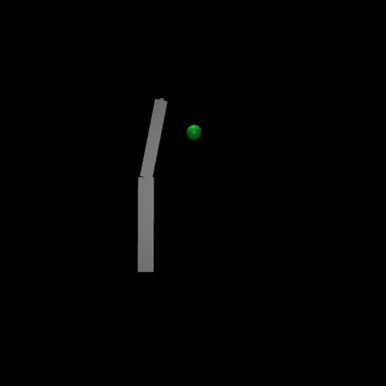
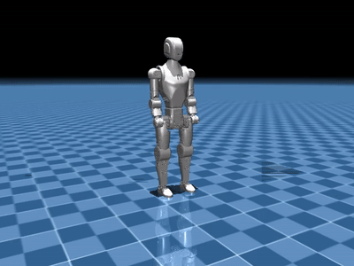

# mujoco-sim

Robotics simulation with [MuJoCo](https://github.com/google-deepmind/mujoco): load a robot described in a URDF file, add what URDF cannot describe (floor, light, camera, motors) and simulate it.

## Reaching demo



*PPO agent moving the arm tip to random targets (green). Video: [docs/demo_policy.mp4](docs/demo_policy.mp4). Regenerate with `python scripts/make_video.py` after training (see `docs/reach_rl.md`; needs `requirements-rl.txt` and `requirements-video.txt`).*

## Setup

Run everything from `sim/mujoco/`.

```bash
python -m venv .venv
.venv\Scripts\Activate.ps1      # Windows PowerShell (Linux/macOS: source .venv/bin/activate)
pip install -r requirements.txt
pip install -e .
```

Optional dependencies are in `requirements-rl.txt` (reinforcement learning) and `requirements-video.txt` (video recording), when present.

## Asimov demo



*Asimov v1 standing for 8 simulated seconds, with a 100 N push on the pelvis at 4 s. Video: [docs/asimov_stand.mp4](docs/asimov_stand.mp4). Regenerate with `python scripts/asimov_stand.py --push 100` (needs `requirements-video.txt` and the model, see `docs/asimov_standing.md`).*

## Tests

```bash
python -m pytest -v
```

Each feature has its own page under `docs/`.
