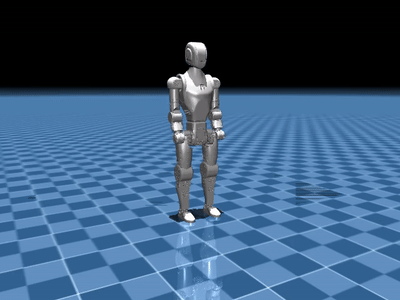

# Asimov v1 standing

Asimov v1 (25 joints, 35.6 kg) is loaded from `models/asimov_1_25dof/xml/asimov_1_25dof.xml`. Set `ASIMOV_XML` to use another path.

The MJCF has a floor and a floating base but no actuators, so `mujoco_sim.humanoid.build_asimov` adds one position servo per joint:

- legs (hip, knee, ankle): stiffness 150, damping 6
- waist, neck, arms: stiffness 40, damping 2
- torque limits come from the `actuatorfrcrange` of each joint

## Standing controller

Servos alone hold the zero pose, but the robot then falls backwards after about 2 s: its centre of mass is close to the heels. `StandingController` shifts the ankle pitch targets by `1.0 * pitch + 0.1 * pitch_rate` of the pelvis.

## What was tested

Simulation only, no noise, flat floor, on MuJoCo 4.0.1.

- Standing for 120 simulated seconds: pelvis height stays at 0.630 m, drift 1 mm, pitch -0.8 degrees.
- A forward push of 100 N for 0.1 s on the pelvis is absorbed. 150 N makes it fall.
- Without the controller the robot falls within 4 s (covered by a test).



## Not covered

Walking, other floors, and any real-robot behaviour.

## Tests

```bash
python -m pytest test/test_humanoid.py -v
```

They are skipped when the Asimov model is not found.
